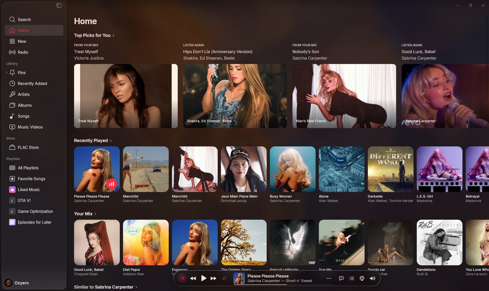
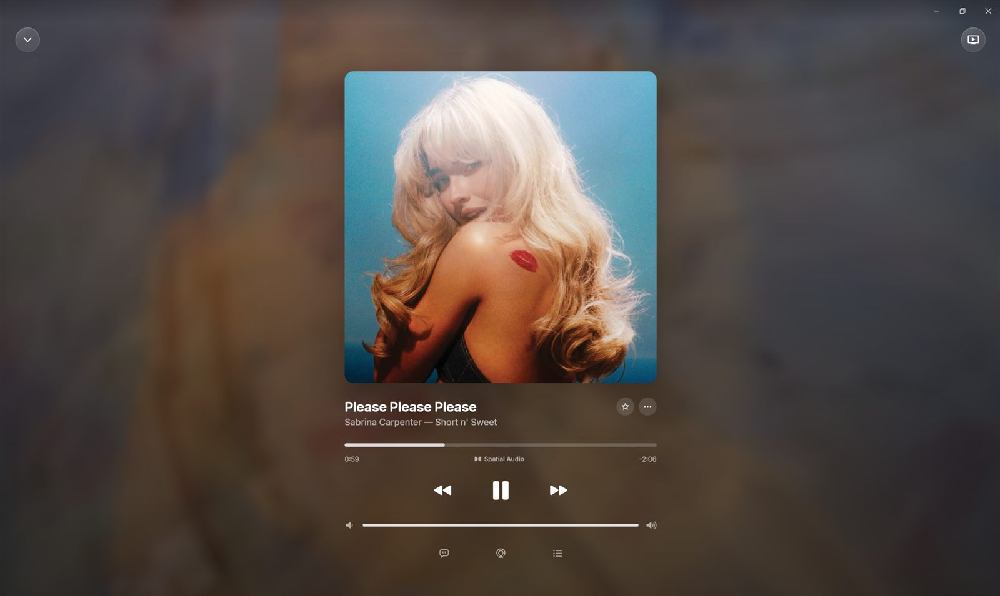
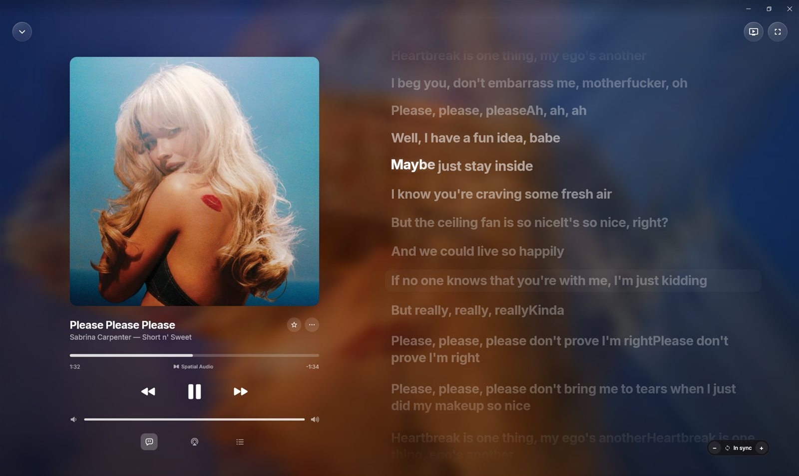
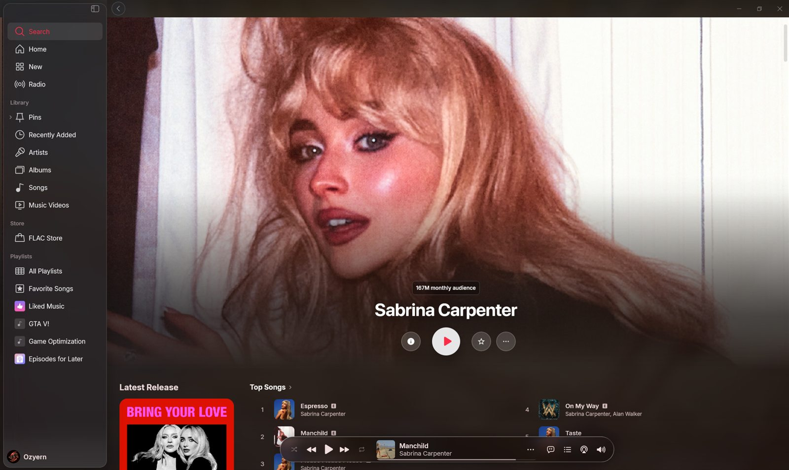
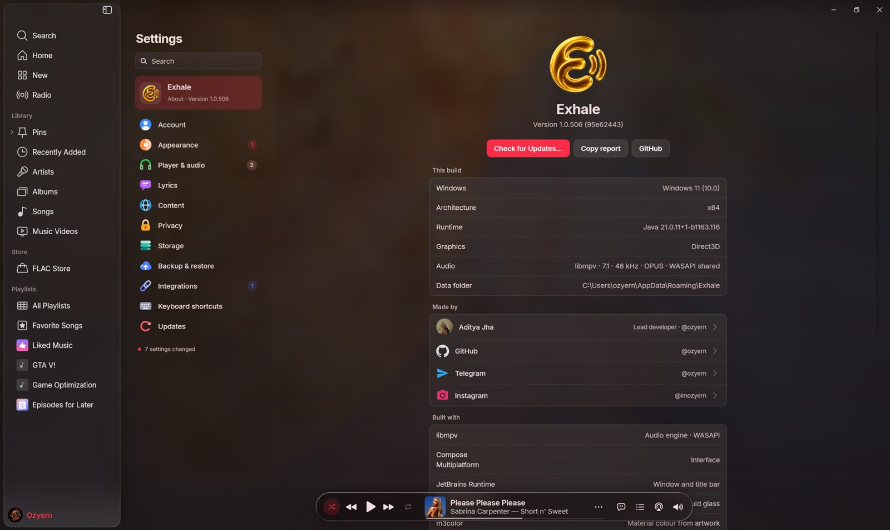

<p align="center">
  
</p>

<h1 align="center">Exhale</h1>

<p align="center">
  <em>A fast, open-source music player for Android and Windows that doesn't suck.</em>
</p>

<p align="center">
  <a href="https://android.com"></a>
  <a href="https://github.com/ozyern/exhale/releases/latest"></a>
  <a href="https://kotlinlang.org"></a>
  <a href="https://developer.android.com/jetpack/compose"></a>
  <a href="https://github.com/ozyern/Exhale/releases"></a>
  <a href="https://github.com/ozyern/exhale/releases"></a>
  <a href="LICENSE"></a>
</p>

---

## What is this?

Welcome to **Exhale**. Honestly, I just got tired of music apps that look clunky and run poorly, so I built this.

The goal was simple: combine the slick, glassy look of Apple Music with the straightforward layout of Spotify. I added what I'm calling a "Brina Glass" effect — the background is a slow, moving gradient that blurs behind frosted glass panels. It looks great while music is playing.

I also spent way too much time on the animations. Scrolling feels bouncy, buttons actually react when you press them, and the whole thing recolors itself to match your album art. It's the little things.

And since 1.0.506 there's **Exhale for Windows** too — the same library, lyrics and sound on your PC, in a desktop app built the way Apple Music is on the Mac.

## Screenshots

### Android

<p align="center">
  
  
  
  
  
</p>

### Windows

<p align="center">
  
</p>
<p align="center">
  
  
</p>
<p align="center">
  
  
</p>

## Features

**Look and feel**

- **Brina Glass UI** — live, dynamic backdrop blurs. (Shoutout to [Haze](https://github.com/chrisbanes/haze) for making this possible.)
- **Dynamic theming** — the app's colors adapt to whatever album art is on screen, and you can build your own themes from scratch.
- **Always-on display** — a nice now-playing screen when your phone's idle.

**Listening**

- **Stream & offline** — play directly or download tracks for when you've got no signal.
- **Synced lyrics** — real-time, line-by-line lyrics that follow the track.
- **Built-in equalizer** — tweak the sound to taste.
- **Android Auto** — take it on the road.

**Everything else**

- **Scrobbling** — Last.fm and ListenBrainz support so your listening history stays yours.
- **Discord Rich Presence** — show off what you're playing.
- **Music Together** — listen in sync with friends.
- **Backup & restore** — your library and settings, portable.

**On Windows**

- **Apple Music's layout** — a glass sidebar (Library, Pins, the FLAC Store, your playlists) and a floating player bar.
- **Music videos up to 2160p** — with the lyrics laid over the picture, and the video keeps playing in the player bar when you close the full player.
- **Serious audio** — Dolby passthrough to your receiver or soundbar, WASAPI exclusive mode, a high-quality resampler, and lossless copies from your own folders played in place of the stream.
- **At home on the desktop** — media keys, the Windows media panel, the tray, Discord and Last.fm.
- **Updates itself** — it finds new releases on GitHub, checks them against their checksum and installs them.

Built in Kotlin with Jetpack Compose throughout — no legacy Views anywhere. The Windows app is Compose Multiplatform, playing through libmpv.

## Want to try it?

Grab the latest `.apk` from the [Releases](https://github.com/ozyern/Exhale/releases) page and sideload it.
F-Droid is coming soon.

**Requirements:** Android 13 (API 33) or newer.

On **Windows 10 or 11 (64-bit)**, download `Exhale-Setup-<version>.exe` from the same release — every
release carries both the APK and the Windows setup. It installs for your user only, with no admin
rights, updates itself from then on, and *Uninstall Exhale* in Installed apps removes it again.

## Building from source

You'll need **JDK 21** and **SDK Platform 37**.

```bash
git clone https://github.com/ozyern/Exhale.git
cd Exhale
./gradlew assembleUniversalDebug
```

The APK lands in `app/build/outputs/apk/universal/debug/`.

There are five ABI flavors, so plain `assembleDebug` builds all of them — use `assembleUniversalDebug`
for one APK that runs anywhere, or `assembleArm64Debug` if you're only testing on a modern phone.

For the **Windows app** you'll need the JetBrains Runtime 21 (JBR) and libmpv:

```powershell
powershell -ExecutionPolicy Bypass -File desktop\scripts\fetch-libmpv.ps1   # libmpv-2.dll, once
.\gradlew.bat :desktop:run                                                # run it
powershell -ExecutionPolicy Bypass -File desktop\scripts\build-installer.ps1 -Unsigned   # Exhale-Setup-<version>.exe
```

The setup lands in `desktop/build/installer/`. More in the [Contributing Guidelines](CONTRIBUTING.md).

## Credits

A massive thanks to the original developer of **OpenTune**. Exhale is built directly on top of their
work — without it, this project wouldn't exist. Check out the OG repo:
[OpenTune by Arturo254](https://github.com/Arturo254/OpenTune).

## Contributing

Pull requests are always welcome — a bug fix, a UI tweak, even a typo. Check out the
[Contributing Guidelines](CONTRIBUTING.md) if you want to dive in.

## Privacy

Exhale has no account of its own, no ads and no analytics. It connects only to the services that play
and describe your music, and the optional ones (Last.fm, ListenBrainz, Discord) stay off until you turn
them on. The full list is in the [privacy policy](PRIVACY.md), and the Windows installer shows it before
anything is installed.

## Code signing policy

Free code signing provided by [SignPath.io](https://about.signpath.io/), certificate by
[SignPath Foundation](https://signpath.org/).

Windows releases are built from this repository by GitHub Actions
([release workflow](.github/workflows/release.yml)) and signed only after a manual approval for each
release.

- Committers and reviewers: [ozyern](https://github.com/ozyern)
- Approvers: [ozyern](https://github.com/ozyern)

Privacy: see the [privacy policy](PRIVACY.md). This program does not send any information to the
developer, and only connects to the services listed there.

## License

Exhale is released under the [GNU GPL v3](LICENSE).

---

<p align="center">
  Built for the Android and Windows community.
</p>
